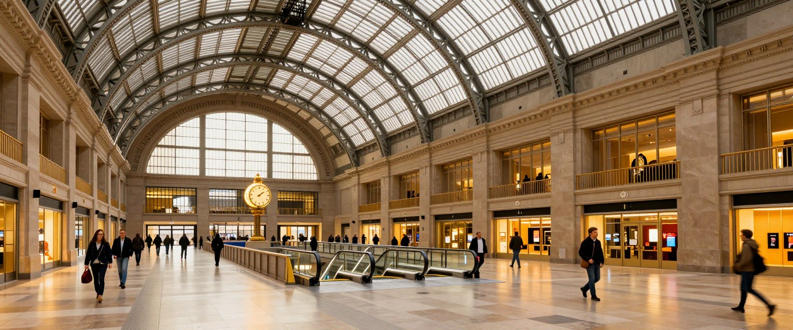

# gm_penn_modern

**Play it:** [Steam Workshop: Penn Station today (gm_penn_modern)](https://steamcommunity.com/sharedfiles/filedetails/?id=3846578407)

A Garry's Mod map of today's New York Penn Station, built at true scale (1 ft = 12 units). Release 0.2.0 has two areas. Moynihan Train Hall is the 2021 hall in the old Farley post office across Eighth Avenue: a 31,000 sq ft room under a 92 ft glass skylight on gabled steel trusses, the four-faced clock, shop fronts under balconies on both sides, stairs up to the balconies, and two pairs of escalators down to the West End Concourse. From there a passage under Eighth Avenue leads into the LIRR concourse under Madison Square Garden, rebuilt in 2023: a 57 ft wide, 18 ft high corridor with wood-slat and lit white ceilings, white-and-blue columns carrying departure boards, ticket machines, and the 33rd Street entrance hall with its 40 ft lit ceiling grid and an escalator up toward the street. The Amtrak and NJ Transit concourses, the platforms and the Eighth Avenue entrances come next (see the [plan](ai-docs/plans/penn-modern-plan.md)).

The map is written as VMF text by a Python script, not drawn in Hammer. The textures (floor, stone, shop fronts, LED boards, skylight glass) and the models (trusses, skylight, clock, escalators, departure boards, ticket machines) are made by scripts in `tools/`.

Screenshots from release 0.2.0:

| | |
|---|---|
| 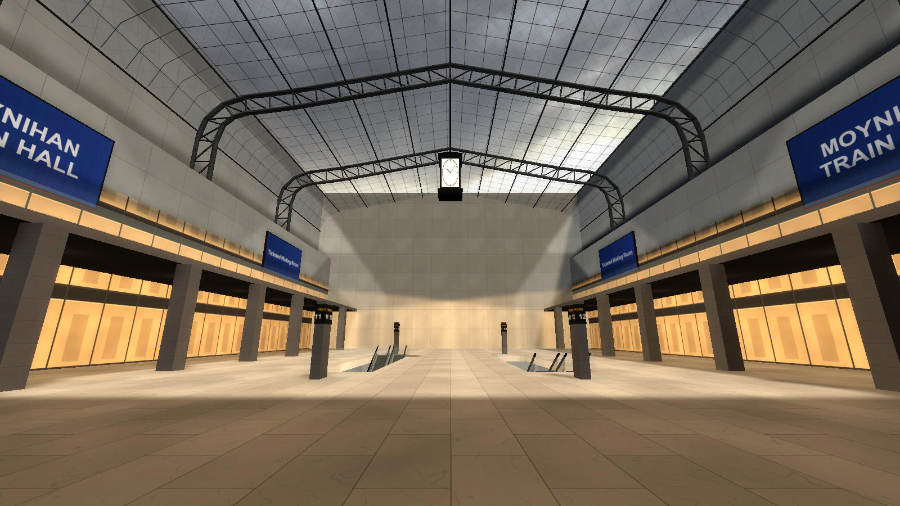 | 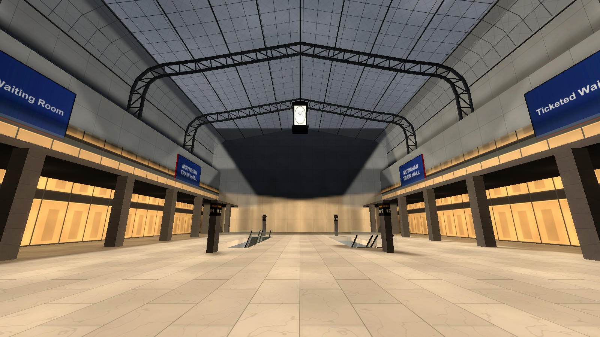 |
| 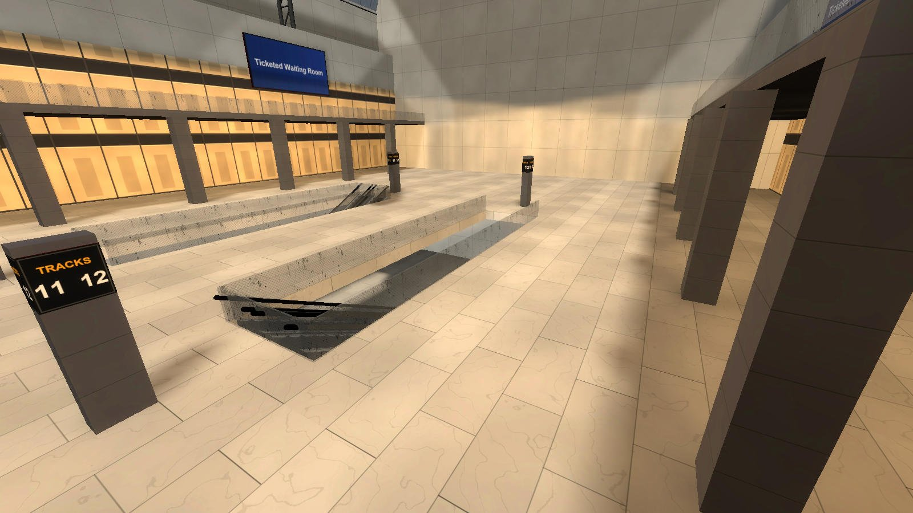 | 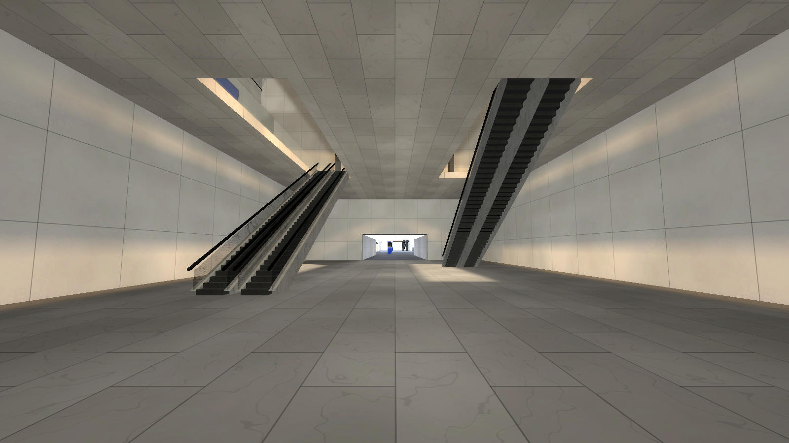 |
| 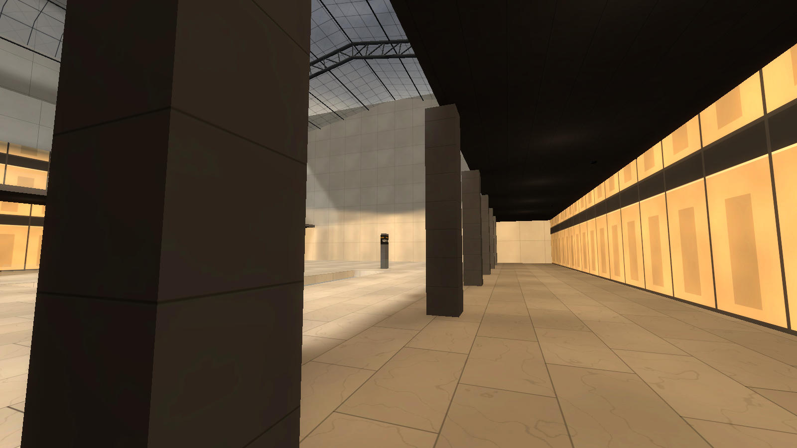 | 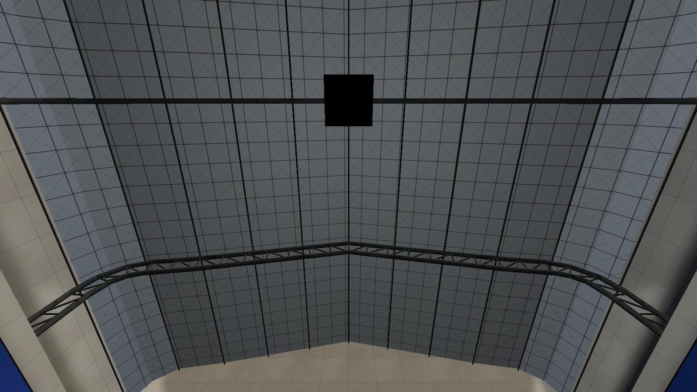 |
| 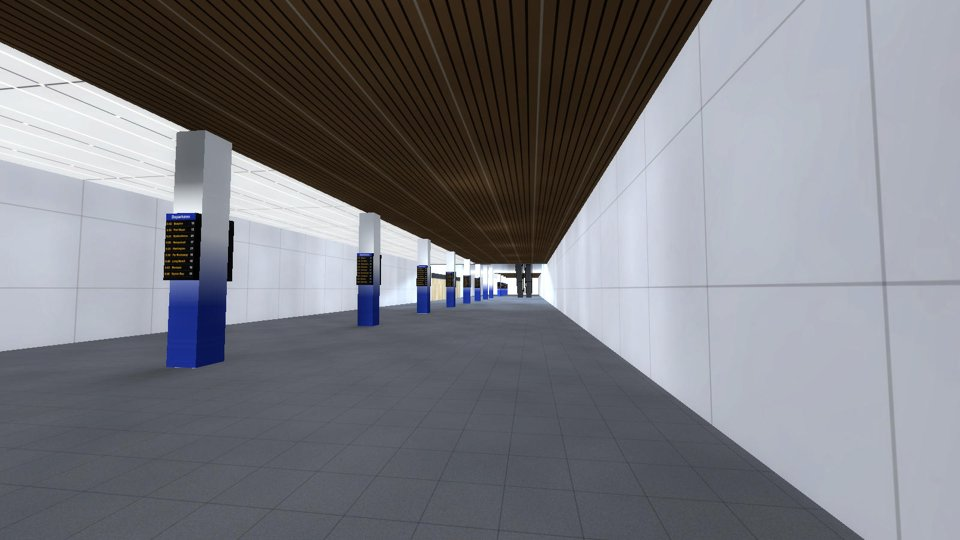 | 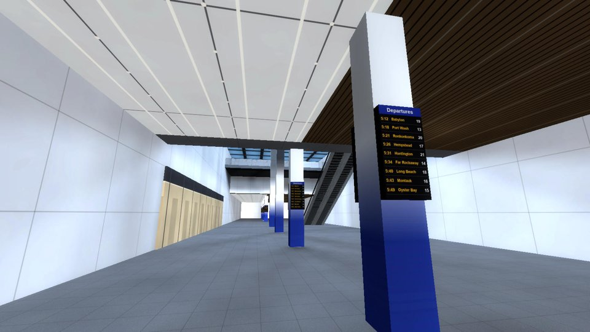 |
| 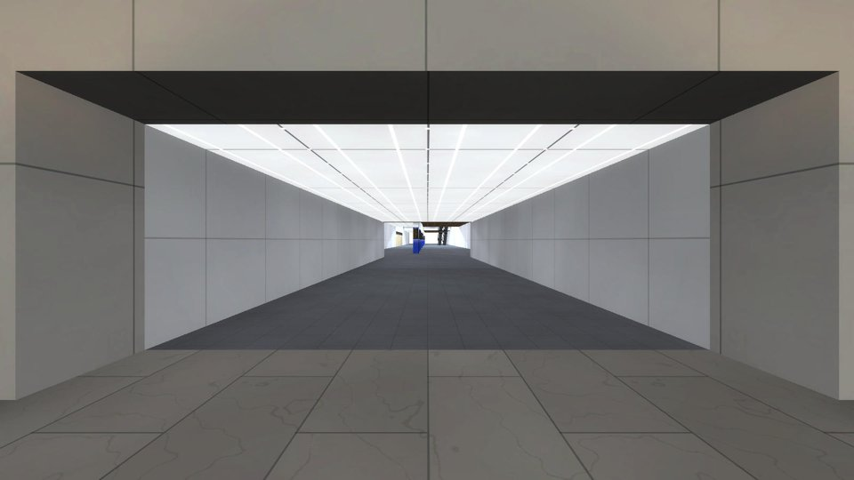 | 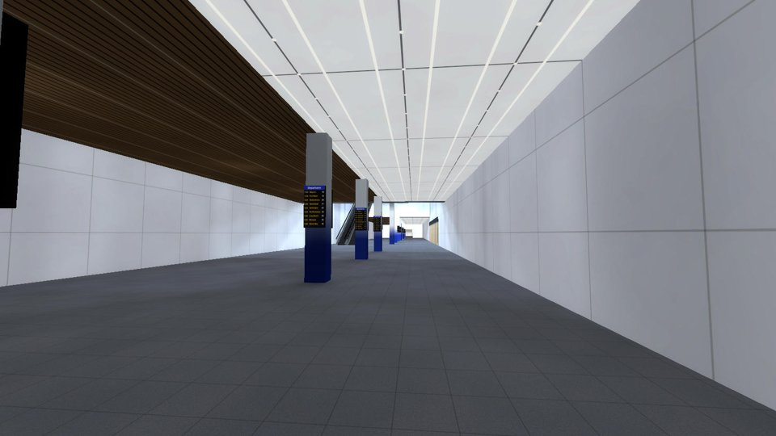 |

### Level map

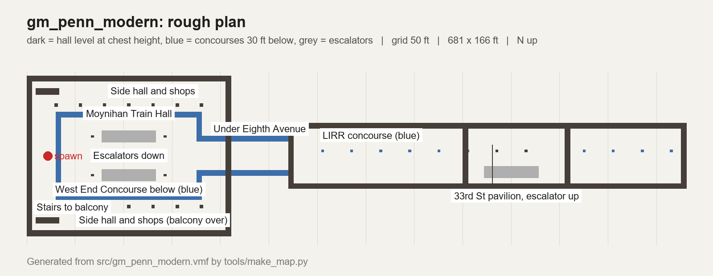

## Build

Needs Garry's Mod (set `GMOD` if it is not in `D:/SteamLibrary/steamapps/common/GarrysMod`), Python 3 with Pillow, numpy and srctools, and Git Bash.

```sh
sh tools/compile.sh          # VMF, textures, models, vbsp/vvis/vrad, pack, copy to garrysmod/maps
UNCAP=1 sh tools/shots.sh    # screenshots and fps into shots/
sh tools/walk.sh             # walks every stair and escalator, PASS/FAIL per route
python tools/make_map.py     # docs/level-map.png
```

## Credits and licence

- Reference photos: Wikimedia Commons, CC0, CC BY and CC BY-SA, each with author and licence in [refs/SOURCES.md](refs/SOURCES.md). Used for proportions and colour only; none are in the map.
- Stock Half-Life 2 materials ship with Garry's Mod and are not bundled.
- The banner above was made with the Z-Image Turbo model (Apache-2.0) and is AI art, not a screenshot. No AI images are in the map.
- Tools: MIT ([LICENSE](LICENSE)). Map source, generated textures and screenshots: CC BY-SA 4.0.

Not affiliated with Amtrak, the LIRR, the MTA, NJ Transit or the Empire State Development Corporation.
